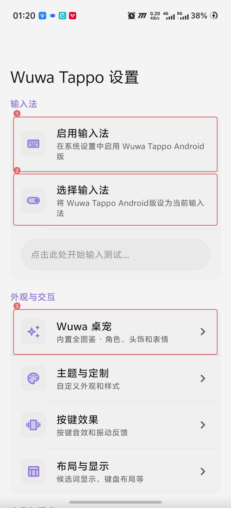

  

<h1 align="center">WuwaTappo Android版</h1>

  <strong>将官方 WuwaTappo 桌宠移植至安卓输入法，让喜欢的角色陪你打字。</strong>

  默认中文九键 · 内置全图鉴 · 独立悬浮桌宠 · 打字互动与戳戳表情

  
  
  

  <a href="#下载安装">下载安装</a> ·
  <a href="#首次使用">首次使用</a> ·
  <a href="#权限说明">权限说明</a> ·
  <a href="#桌宠设置">桌宠设置</a> ·
  <a href="#常见问题">常见问题</a>

---

## 这是什么项目？

**WuwaTappo Android版**将官方 WuwaTappo 桌宠移植至安卓输入法，把电脑版的角色形象、头饰、表情和打字互动带到手机上。保留日常中文、英文输入能力，让桌宠在聊天和输入时陪在旁边。

当你在手机上聊天、搜索或记笔记时，角色会以一个独立的小悬浮窗出现在键盘外：按下键盘，桌宠跟着做动作；停下来，它会回到待机并眨眼。你也可以轻轻戳它，让选好的表情弹出来，连续戳戳也可以连续触发。

桌宠使用电脑版提取的原始角色、头饰和表情图片，动作按电脑版的节奏实现。它不占用键盘内部的一块区域，可以移动位置、调整大小，也可以开启触摸穿透，方便继续点按下方的聊天界面。

保留输入法原有功能和网络能力。**不加入 Wuwa Tappo 的房间和联机功能**；桌宠的素材读取、打字动作和戳戳反馈在手机本地完成。

本项目为个人移植版本，并非 WuwaTappo 官方推出的 Android 应用。

## 有哪些功能？

| 功能 | 说明 |
| --- | --- |
| 正常中文与英文输入 | 保留 Xime 原有输入能力，新安装默认中文九键拼音，可自行切换方案和语言。 |
| 保留 Xime 功能 | 保留全键盘、五笔、手写、语音、主题、插件、扩展商店、剪贴板和同步等能力；部分功能仍需按上游要求下载模型、安装插件或配置服务。 |
| 独立悬浮桌宠 | 桌宠显示在键盘外，可移动、缩放，键盘收起后隐藏。 |
| 内置全图鉴 | 当前内置 **260 套外观、135 个头饰、504 个表情**，安装后无需手动导入素材，也不需要抽取或逐个解锁。 |
| 打字动作 | 按键时切换敲击动作，停止输入后恢复待机，保留定时眨眼。 |
| 表情与戳戳 | 最多选择 6 个表情，打字时偶尔弹出 1–2 个；轻触角色立即触发，支持连续戳戳。 |
| 随时开关 | 可以关闭桌宠继续使用输入法，也可以在设置中重新开启。 |
| 触摸穿透 | 开启后可以点到桌宠下方的应用；此模式下不能戳戳或拖动桌宠。 |

## 下载安装

**系统要求：Android 9 或更新版本，arm64-v8a（64 位 ARM）设备。**

安装包文件名：`Wuwa-Tappo-Android-1.0-arm64-v8a.apk`。

安装包计划提供在本仓库的 [Releases](https://github.com/Averionx/WuwaTappo-Android/releases) 页面。**目前先公开项目介绍与使用说明，APK 和完整源码尚未上传，请勿把空的 Releases 页面当作下载故障。** 本地测试 APK 已包含桌宠素材，使用者不需要下载整个源码文件夹。

1. 将 APK 下载或传到手机上，用文件管理器打开安装。
2. 如果系统提示不允许安装未知应用，按系统指引允许当前打开 APK 的浏览器或文件管理器安装应用。
3. 安装后打开 **Wuwa Tappo Android版**，按下面的步骤启用输入法和桌宠。

本应用使用独立包名，可与 Xime 官方版并存。从其他输入法切换过来时，需要重新启用本应用；其他输入法的个人词库和设置不会自动迁入。

## 首次使用

下图为 **Android 16 / vivo 真机**上的设置首页。红框 **① 启用输入法 → ② 选择输入法 → ③ Wuwa 桌宠** 对应下面的操作步骤；首次安装如果先显示设置向导，请先按向导选择并部署输入方案，再回到此页。不同系统的权限页面名称和样式可能不同。

  

### 1. 启用并切换输入法

打开应用，按引导进入系统的输入法管理页面，启用 **Wuwa Tappo Android版**，再将它选为当前输入法。不同手机的入口名称可能是“键盘与输入法”“管理键盘”或“语言与输入法”。

完成应用内的方案选择和部署，等待部署完成，再打开一个普通文本输入框测试。首次部署词库需要一定时间，请等待应用给出的完成提示。

新安装默认使用 **拼音九键、中文输入**。想用全键盘或五笔，可以在 **键盘菜单 → 输入方案** 中选择相应方案；中英文切换键保留。数字输入框和密码框仍按各自的输入规则工作。

### 2. 打开桌宠设置

以下两个入口都可以：

- **键盘菜单 → Wuwa 桌宠**。
- **应用设置 → 外观 → Wuwa 桌宠**。

进入后等待“全图鉴已就绪”，即可选择角色、头饰和表情。**图鉴已经内置，无需首次手动导入。**

### 3. 授予悬浮窗权限

在桌宠设置里点击 **管理悬浮窗权限**，进入系统页面，找到本应用并允许：

> **显示在其他应用上层 / 悬浮窗 / 在其他应用上方显示**

返回桌宠设置，打开 **开启悬浮桌宠**。然后在普通输入框中调出本输入法，检查角色是否出现在键盘上方。

**没有悬浮窗权限时，桌宠不能显示在键盘外，基础输入功能仍可使用。** 部分厂商还会提供“后台弹出界面”等额外开关，请结合手机实际提示检查。

## 权限说明

| 权限或系统设置 | 用途 | 什么时候需要 |
| --- | --- | --- |
| 启用输入法 | 让系统允许本应用提供键盘输入 | 使用本输入法时需要。 |
| 显示在其他应用上层（悬浮窗） | 在键盘外显示和触摸桌宠 | 使用独立悬浮桌宠时需要。 |
| 麦克风 | 语音转文字 | 使用语音输入时按提示授权；桌宠本身不需要。 |
| 网络 | Xime 的扩展商店、在线语音、插件、同步和更新等 | 对应联网功能使用时需要，按所选服务和插件的配置工作。 |

桌宠不需要无障碍、录屏权限，也没有单独的常驻桌宠后台服务。它跟随输入法窗口显示：**收起键盘后隐藏，进入密码输入框时也会隐藏。**

系统可能会弹出“输入法可能收集输入内容”的通用提示。桌宠动作接口只接收敲击通知，不接收输入字符、候选词或聊天内容；Xime 和用户安装插件的行为仍按其各自实现与配置运行。

## 桌宠设置

| 设置 | 使用方法 |
| --- | --- |
| 开启悬浮桌宠 | 打开或关闭桌宠，不影响继续使用输入法。 |
| 角色 | 点击角色按钮，搜索并选择喜欢的外观。 |
| 头饰 | 搜索并选择配件，也可以选择“无头饰”。 |
| 选择表情 | 最多选择 6 个。打字时从所选表情中偶尔弹出，戳戳会立即触发；不选择时不弹出。 |
| 预览戳戳 | 在设置里查看角色和表情反馈。 |
| 拖动桌宠 | 开启后可拖到合适位置；轻触仍可触发戳戳。 |
| 触摸穿透 | 开启后将触摸交给下方应用，此时不能戳戳或拖动。需要移动时先关闭穿透。 |
| 桌宠大小 | 调整角色窗口大小，减少对聊天内容的遮挡。 |
| 恢复桌宠位置 | 找不到角色或位置不合适时，恢复默认位置。 |
| 更新本地素材（可选） | 用兼容的本地素材包替换资源，平时无需操作。 |

更详细的手机使用说明见 [手机测试与权限说明](docs/PHONE_TESTING.md)。

## 常见问题

### 已经安装了，为什么没有桌宠？

先确认当前输入法是 **Wuwa Tappo Android版**，再检查“开启悬浮桌宠”和系统悬浮窗权限。桌宠需要在本输入法的键盘显示时才会出现；桌面空闲时、键盘收起后和密码输入框中都不会显示。

如果已授权仍不显示，可以关闭再打开桌宠，检查厂商系统是否另有限制悬浮显示的开关。

### 为什么不能戳戳或拖动？

检查是否开启了 **触摸穿透**。穿透开启时，点击会交给下方应用。关闭穿透后恢复戳戳；需要移动角色时，再打开“拖动桌宠”。

### 怎么切换九键和全键盘？

打开 **键盘菜单 → 输入方案**，选择“拼音九键”使用九键，选择普通拼音方案使用全键盘，也可以切换到五笔或自行添加的其他方案。确认相应方案已经启用并完成部署。

### 图鉴需要登录、联网解锁或另外导入吗？

不需要。当前 APK 已内置上述外观、头饰和表情，进入设置后自动准备本地资源。Wuwa Tappo 的房间、联机和账号库存不在本项目功能范围内。Xime 原有联网功能仍然保留。

### 为什么版本里既有 1.0，又有 3.4.1？

**1.0 是本项目的桌宠整合版编号，3.4.1 是 Xime 的宿主兼容版本。** 保留宿主版本是为了让原有插件、商店和布局配置正确判断兼容性，关于页面会同时显示两者。

### 可以直接安装 Xime 官方更新吗？新增角色会自动同步吗？

Xime 官方 APK 不包含本项目的桌宠整合，请使用本项目提供的新版 APK 更新桌宠版。新增图鉴需要更新资源清单并重新构建本项目，不能保证跟随电脑版或 Xime 的更新自动加入。

## 使用前请了解

- 当前 APK 使用 **Android Debug 签名**，属于测试构建。覆盖更新需要兼容的包名和签名；卸载会清除本应用的本地词库、设置和桌宠配置，操作前请先备份需要的数据。
- 已完成 **263 项定向自动化测试**，以及 APK 签名、资源完整性和原生库 16 KB ELF 对齐检查；已在 Android 16 真机完成覆盖安装及设置首页检查，**完整输入与悬浮窗流程尚未完成实测**。不同机型的显示效果、长时间输入、耗电和厂商权限策略仍需实测。
- 保留 Xime 的功能代码与网络权限，不代表每个第三方插件、模型或在线服务均已逐一验证可用。
- 桌宠会占用一定内存与绘制资源。若影响使用，可以缩小或关闭桌宠，继续使用输入法。

遇到问题时，请附上手机型号、Android 版本、所选输入方案、问题页面及复现步骤。提供截图或日志前请去掉密码、聊天内容和其他个人信息。

## 来源、许可与开发说明

项目移植与维护：**Averionx**。

输入法基础来自 [Xime](https://github.com/ximeiorg/Xime)，桌宠图像与本 README 顶部、APK 使用的 Logo 来自 Wuwa Tappo 桌面版原始资源。

源代码按 [GPLv3](LICENSE) 条款分发；移植桌宠模块保留其 [LGPL-2.1-or-later](LICENSES/LGPL-2.1-or-later.txt) 文件头及许可说明。上游品牌限制见 [TRADEMARKS.md](TRADEMARKS.md)。

**Logo、角色、头饰和表情素材归原权利人所有，不包含在代码的 GPL/LGPL 开源授权内。** 目前尚未确认这些素材的公开再分发授权；公开发布含素材的 APK 或资源文件前，需要单独确认相关许可。图标来源记录见 [素材说明](docs/WUWA_ASSETS.md)。

构建方式、测试范围和发布准备见以下文档：

- [源码构建与 GitHub 发布说明](docs/GITHUB_RELEASE.md)
- [验证记录与当前限制](docs/WUWA_VALIDATION.md)
- [版本说明](docs/RELEASE_NOTES.md)
- [Xime 上游说明](https://github.com/ximeiorg/Xime#readme)
